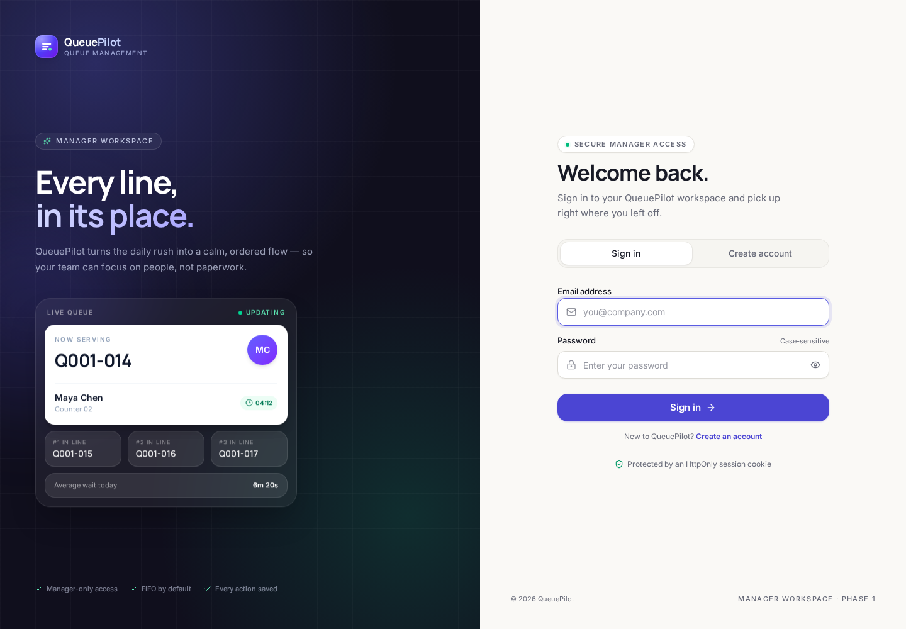
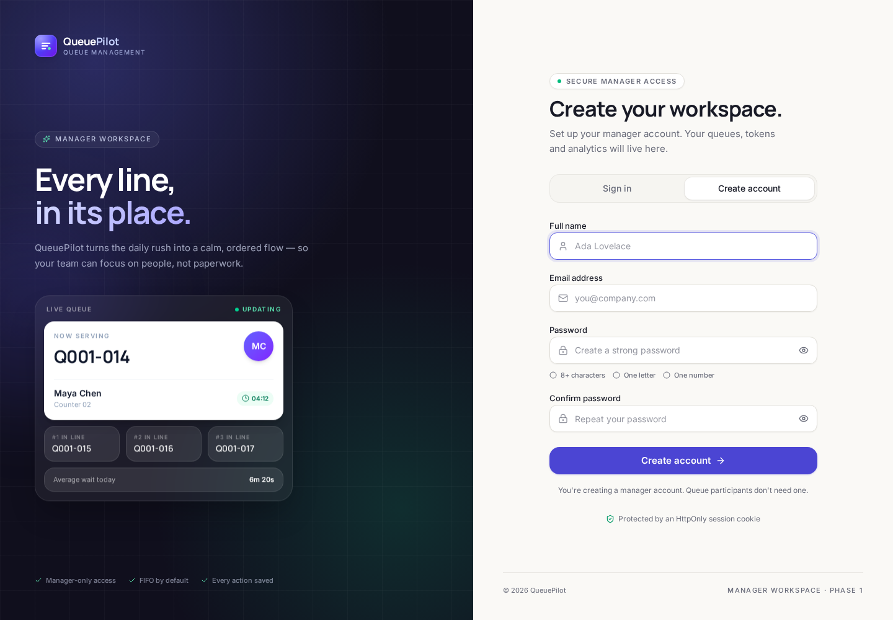
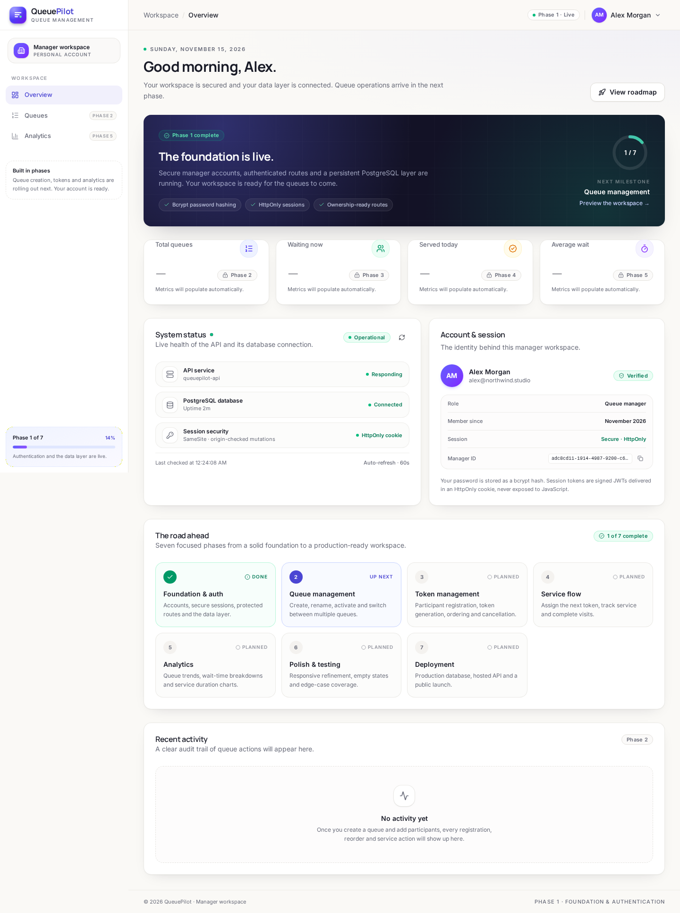
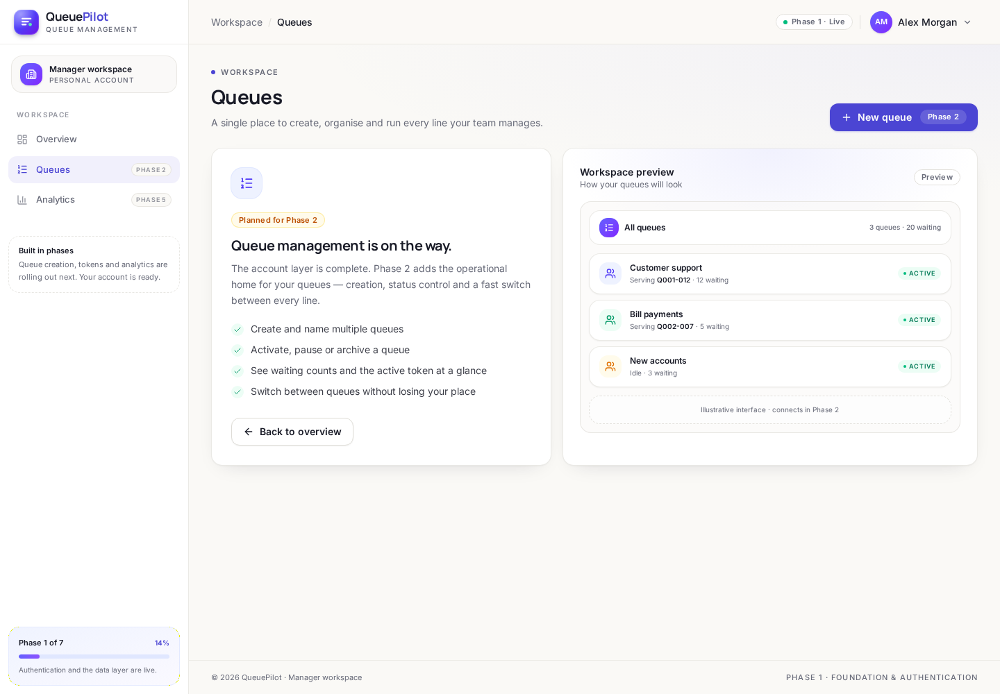
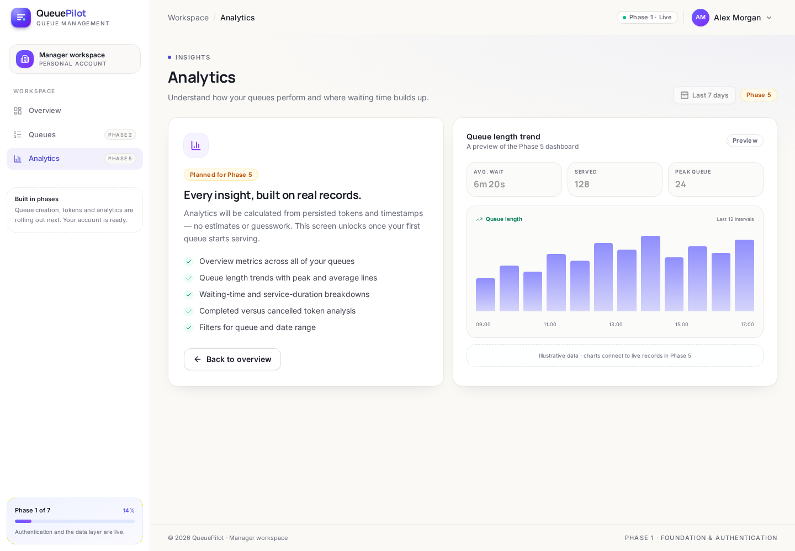
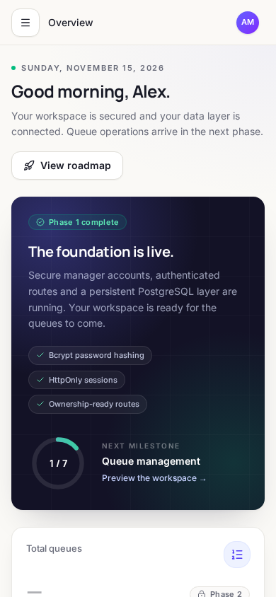

# QueuePilot

**Queue management, cleared for takeoff.**

QueuePilot is a full-stack queue management system for service teams. Managers create queues,
register participants, move tokens, run service, and understand their performance — all from one
calm, responsive workspace.

> **Current milestone: Phase 1 — Project setup & authentication.** The account foundation, database
> layer, API, and protected manager workspace are complete. Queue operations follow in Phase 2.

---

## Phase 1 at a glance

| Area                                                   | Status        |
| ------------------------------------------------------ | ------------- |
| Monorepo setup (API + web)                             | ✅ Complete   |
| PostgreSQL + Prisma schema & migration                 | ✅ Complete   |
| Manager registration & login                           | ✅ Complete   |
| Secure session auth (signed JWT in HttpOnly cookie)    | ✅ Complete   |
| Protected API routes & ownership-ready auth middleware | ✅ Complete   |
| Protected client routes + session restoration          | ✅ Complete   |
| Login / register UI                                    | ✅ Complete   |
| Responsive dashboard shell, status & roadmap           | ✅ Complete   |
| API integration tests                                  | ✅ 16 passing |
| Queue management (Phase 2)                             | ⏳ Next       |

### Screens

| Sign in                                        | Create account                                           |
| ---------------------------------------------- | -------------------------------------------------------- |
|  |  |

| Manager overview                                    | Queues (Phase 2 preview)                               |
| --------------------------------------------------- | ------------------------------------------------------ |
|  |  |

| Analytics (Phase 5 preview)                                  | Mobile overview                                          |
| ------------------------------------------------------------ | -------------------------------------------------------- |
|  |  |

---

## Tech stack

| Layer    | Technology                                             |
| -------- | ------------------------------------------------------ |
| Frontend | React 19 + TypeScript + Vite 8                         |
| Styling  | Tailwind CSS 4 + shadcn-style component primitives     |
| UI       | Radix UI, Lucide icons, Sonner toasts                  |
| Forms    | React Hook Form + Zod                                  |
| Backend  | Node.js + Express 5 + TypeScript                       |
| Database | PostgreSQL 17                                          |
| ORM      | Prisma 6                                               |
| Auth     | Signed JWT (7-day default) in a `HttpOnly` cookie      |
| Testing  | Vitest + Supertest + isolated PostgreSQL test database |

The application follows a three-layer architecture: React presentation layer → Express application
layer → PostgreSQL data layer accessed through Prisma.

---

## Repository layout

```text
queue-manager/
├── apps/
│   ├── api/                    # Express API
│   │   ├── prisma/
│   │   │   ├── schema.prisma   # Manager model + initial migration
│   │   │   └── migrations/
│   │   ├── src/
│   │   │   ├── config/         # Validated environment configuration
│   │   │   ├── lib/            # Prisma client, errors, validation helpers
│   │   │   ├── middleware/     # Auth, error handling, rate limits, origin guard
│   │   │   ├── modules/
│   │   │   │   ├── auth/       # Register, login, logout, me
│   │   │   │   └── health/     # API + database health
│   │   │   ├── app.ts
│   │   │   └── index.ts
│   │   └── tests/              # Auth & hardening integration tests
│   └── web/                    # React SPA
│       └── src/
│           ├── components/     # UI primitives, auth, layout, dashboard
│           ├── hooks/
│           ├── lib/            # API client, formatting, navigation helpers
│           ├── pages/
│           ├── providers/      # Auth context + session restoration
│           └── types/
├── docker/                     # Test-database bootstrap SQL
├── docs/                       # Phase notes + screenshots
├── docker-compose.yml
└── package.json                # npm workspaces + root scripts
```

---

## Quick start

### Prerequisites

- **Node.js 20.19+** and npm
- **Docker** (recommended) or a PostgreSQL 15+ server
- Ports `4000` (API), `5173` (web), and `5432` (Postgres) available

### 1. Install dependencies

```bash
npm install
```

> npm 12 blocks package install scripts by default. The required Prisma/esbuild scripts are
> allow-listed in the root `package.json` (`allowScripts`), so install works without manual approval.

### 2. Configure the API environment

```bash
cp apps/api/.env.example apps/api/.env
```

The example file works out of the box with the included Docker database. Before deploying or
sharing the project, replace `JWT_SECRET` with a long random value:

```bash
openssl rand -base64 48
```

### 3. Start PostgreSQL

```bash
npm run db:up
```

This starts Postgres 17 on `localhost:5432`, creates the `queuepilot` database, and initialises the
`queuepilot_test` database used by integration tests. Data lives in a named Docker volume.

Using your own PostgreSQL instead? Update `DATABASE_URL` in `apps/api/.env` and create both
databases.

### 4. Generate the Prisma client and apply migrations

```bash
npm run db:generate
npm run db:deploy
```

`db:deploy` applies the committed migration without prompting. Use `npm run db:migrate` only when you
change `schema.prisma` during development.

### 5. Start both apps

```bash
npm run dev
```

| Service      | URL                              |
| ------------ | -------------------------------- |
| Web app      | http://localhost:5173            |
| API          | http://localhost:4000            |
| Health check | http://localhost:4000/api/health |

Vite proxies `/api` to the API in development, so cookies stay first-party.

### 6. Create your manager account

Open **http://localhost:5173/register**, create an account, and you will land on the protected
overview. Accounts are real — there are no seeded demo credentials.

---

## Environment variables

### API (`apps/api/.env`)

| Variable           | Required | Default                 | Description                                                          |
| ------------------ | -------- | ----------------------- | -------------------------------------------------------------------- |
| `NODE_ENV`         | No       | `development`           | `development`, `test`, or `production`                               |
| `PORT`             | No       | `4000`                  | API port                                                             |
| `DATABASE_URL`     | **Yes**  | —                       | PostgreSQL connection string                                         |
| `JWT_SECRET`       | **Yes**  | —                       | Session signing key, minimum 32 characters                           |
| `SESSION_TTL_DAYS` | No       | `7`                     | Session lifetime (1–30 days)                                         |
| `CLIENT_ORIGINS`   | No       | `http://localhost:5173` | Comma-separated allowed browser origins                              |
| `COOKIE_NAME`      | No       | `qp_session`            | Session cookie name                                                  |
| `COOKIE_SECURE`    | No       | `auto`                  | `auto`, `true`, or `false`; `auto` is secure in production           |
| `COOKIE_SAME_SITE` | No       | `auto`                  | `auto`, `lax`, `strict`, or `none`; `auto` uses `none` in production |
| `COOKIE_DOMAIN`    | No       | —                       | Optional cookie domain for subdomains                                |
| `TRUST_PROXY`      | No       | `0`                     | Set to `1` behind a reverse proxy / load balancer                    |

The API validates its environment at boot and refuses to start with an invalid configuration.

### Web (`apps/web/.env`)

| Variable           | Required | Description                                                                                                      |
| ------------------ | -------- | ---------------------------------------------------------------------------------------------------------------- |
| `VITE_API_URL`     | No       | Absolute API URL when the API is on a different origin. Leave empty to use the dev proxy / same-origin requests. |
| `VITE_DEV_API_URL` | No       | Dev proxy target. Defaults to `http://localhost:4000`.                                                           |

Copy `apps/web/.env.example` to `apps/web/.env` only if you need to override these values.

---

## Available scripts

Run from the repository root:

| Script                      | Description                                    |
| --------------------------- | ---------------------------------------------- |
| `npm run dev`               | Run API and web app together                   |
| `npm run dev:api`           | Run only the API with hot reload               |
| `npm run dev:web`           | Run only the web app                           |
| `npm run build`             | Production build of API and web                |
| `npm run typecheck`         | TypeScript checks for both apps                |
| `npm test`                  | API integration tests (isolated test database) |
| `npm run format`            | Format with Prettier                           |
| `npm run db:up` / `db:down` | Start / stop the Docker database               |
| `npm run db:generate`       | Generate the Prisma client                     |
| `npm run db:deploy`         | Apply committed migrations                     |
| `npm run db:migrate`        | Create/apply a development migration           |
| `npm run db:studio`         | Open Prisma Studio                             |

---

## API reference (implemented)

All endpoints are prefixed with `/api`. Responses are JSON. Protected endpoints accept the session
cookie automatically, or an `Authorization: Bearer <token>` header.

### Authentication

| Method | Endpoint             | Auth     | Description                                  |
| ------ | -------------------- | -------- | -------------------------------------------- |
| `POST` | `/api/auth/register` | Public   | Create a manager account and start a session |
| `POST` | `/api/auth/login`    | Public   | Authenticate and start a session             |
| `POST` | `/api/auth/logout`   | Public   | Clear the session cookie                     |
| `GET`  | `/api/auth/me`       | Required | Return the current manager                   |

**Register request**

```json
{
  "name": "Ada Lovelace",
  "email": "ada@example.com",
  "password": "Analytical1"
}
```

**Success response** — `201 Created`

```json
{
  "manager": {
    "id": "d9a9e6f0-…",
    "name": "Ada Lovelace",
    "email": "ada@example.com",
    "createdAt": "2026-11-15T00:00:00.000Z",
    "updatedAt": "2026-11-15T00:00:00.000Z"
  }
}
```

A `Set-Cookie` header carries the signed session. Password hashes and other sensitive columns are
never returned.

### Health

| Method | Endpoint      | Auth   | Description                            |
| ------ | ------------- | ------ | -------------------------------------- |
| `GET`  | `/api/health` | Public | API uptime and PostgreSQL connectivity |

### Error format

```json
{
  "error": {
    "code": "INVALID_CREDENTIALS",
    "message": "Incorrect email or password."
  }
}
```

Validation failures add a `details.fieldErrors` object. Known codes in Phase 1:
`VALIDATION_ERROR`, `INVALID_JSON`, `UNAUTHORIZED`, `FORBIDDEN`, `NOT_FOUND`, `EMAIL_TAKEN`,
`INVALID_CREDENTIALS`, `RATE_LIMITED`, `INTERNAL_ERROR`.

---

## Authentication & security design

- Passwords are hashed with **bcrypt** (cost 12) and are never logged or returned.
- Sessions are **signed JWTs** (`HS256`, issuer + audience checked) with a 7-day default lifetime.
- The JWT is delivered in a **`HttpOnly`, `SameSite`, `Secure`-aware cookie** and is never exposed to
  client JavaScript.
- Login is timing-resistant: unknown emails still run a bcrypt comparison against a dummy hash.
- **Ownership-ready middleware**: protected routes resolve the manager from the database on every
  request, so deleted/invalid accounts are rejected immediately.
- **CSRF defence-in-depth**: state-changing requests with an unknown browser `Origin` are rejected.
- **CORS** is allow-listed and credentialed; cookies are scoped to `/`.
- Auth endpoints are **rate limited** (25 attempts / 15 minutes / IP).
- **Helmet** security headers, 100 KB JSON body limit, and generic 500 responses in production.
- Input is validated with **Zod** on the server. Email uniqueness is normalised (trim + lowercase),
  and database `P2002` races are converted into a clean `409 EMAIL_TAKEN`.
- API errors use a consistent envelope; stack traces and database internals never reach the client.
- The API refuses to boot with missing or invalid environment variables.

> **Stateless-session note:** logout clears the cookie. Because JWTs are self-contained, an already
> copied token remains valid until expiry; production hardening could add a token version or session
> table for immediate server-side revocation.

---

## Database

Phase 1 introduces the `managers` table:

| Column          | Type         | Notes                        |
| --------------- | ------------ | ---------------------------- |
| `id`            | UUID         | Primary key                  |
| `name`          | VARCHAR(120) | Display name                 |
| `email`         | VARCHAR(255) | Unique, normalised lowercase |
| `password_hash` | VARCHAR(255) | bcrypt hash                  |
| `created_at`    | TIMESTAMPTZ  | Registration time            |
| `updated_at`    | TIMESTAMPTZ  | Last update                  |

The initial migration is committed at `apps/api/prisma/migrations/`. Queue, token, and activity
models are added in their respective phases.

---

## Testing

```bash
npm test
```

- Runs 16 integration tests with Vitest + Supertest against `queuepilot_test`.
- Covers registration, normalisation, duplicate emails, password rules, login, timing-safe failures,
  session restoration, bearer auth, logout, CSRF origin rejection, malformed JSON, and health checks.
- The test runner applies the Prisma schema to the test database automatically.

The web app is also verified end-to-end manually with Playwright across desktop and mobile viewports:
registration → dashboard → queues → analytics → logout → protected-route redirect → login return
path, with zero console errors and no horizontal overflow.

---

## Phase 1 acceptance check

| Requirement                   | Verification                                                                    |
| ----------------------------- | ------------------------------------------------------------------------------- |
| Manager can register          | `POST /api/auth/register`, register screen                                      |
| Manager can log in            | `POST /api/auth/login`, login screen                                            |
| Sessions persist              | Refresh the dashboard; `GET /api/auth/me` restores the session                  |
| Protected API routes          | `/api/auth/me` returns `401` without a session                                  |
| Protected client routes       | Visiting `/queues` signed out redirects to `/login` and returns afterwards      |
| Ownership-ready authorization | Auth middleware loads the manager per request; queue ownership lands in Phase 2 |
| Logout                        | Account menu → Sign out clears the cookie and returns to `/login`               |
| Passwords secure              | bcrypt hash stored; plaintext never persisted or returned                       |
| Database configured           | PostgreSQL 17 + Prisma migration + health check                                 |
| Responsive UI                 | Tested at 1440px and 390px with no horizontal overflow                          |
| Error handling                | Inline validation, server error banners, network failure messaging              |

---

## Deployment notes (for later phases)

The intended production split is **Vercel (web) + Render (API) + Neon PostgreSQL**:

1. Set `NODE_ENV=production`, a strong `JWT_SECRET`, and the Neon `DATABASE_URL` on the API host.
2. Run `npx prisma migrate deploy` as part of the API release/build step.
3. Set `CLIENT_ORIGINS=https://your-web-domain` and `TRUST_PROXY=1`.
4. Because the web and API are on different sites, use `COOKIE_SECURE=true` and
   `COOKIE_SAME_SITE=none`. Both services must be served over HTTPS.
5. Set `VITE_API_URL=https://your-api-domain` in the web build environment.

---

## Roadmap

| Phase | Scope                                                     | Status      |
| ----- | --------------------------------------------------------- | ----------- |
| 1     | Project setup, database, authentication, protected routes | ✅ Complete |
| 2     | Queue creation, listing, rename, activation               | Next        |
| 3     | Participant registration, tokens, ordering, cancellation  | Planned     |
| 4     | Next token, service completion, concurrency safety        | Planned     |
| 5     | Analytics overview, trends, wait times, filters           | Planned     |
| 6     | UI polish, responsive QA, edge-case testing               | Planned     |
| 7     | Deployment, README, demo                                  | Planned     |

See [`docs/PHASE-1.md`](docs/PHASE-1.md) for the completed scope, design decisions, and manual
verification script.

---

## Troubleshooting

| Symptom                                            | Fix                                                                                   |
| -------------------------------------------------- | ------------------------------------------------------------------------------------- |
| API exits with “Invalid environment configuration” | Copy `apps/api/.env.example` → `apps/api/.env`; ensure `JWT_SECRET` is 32+ characters |
| `Can’t reach server` on auth screens               | Confirm the API is running on port 4000 and `curl localhost:4000/api/health` succeeds |
| `P1001: Can’t reach database`                      | Run `npm run db:up`; check `DATABASE_URL` and port 5432                               |
| Test DB missing                                    | Recreate the volume with `npm run db:down && docker compose down -v && npm run db:up` |
| Session not persisted in production                | Use HTTPS, `COOKIE_SECURE=true`, `COOKIE_SAME_SITE=none`, and exact `CLIENT_ORIGINS`  |
| Prisma client missing                              | Run `npm run db:generate`                                                             |
