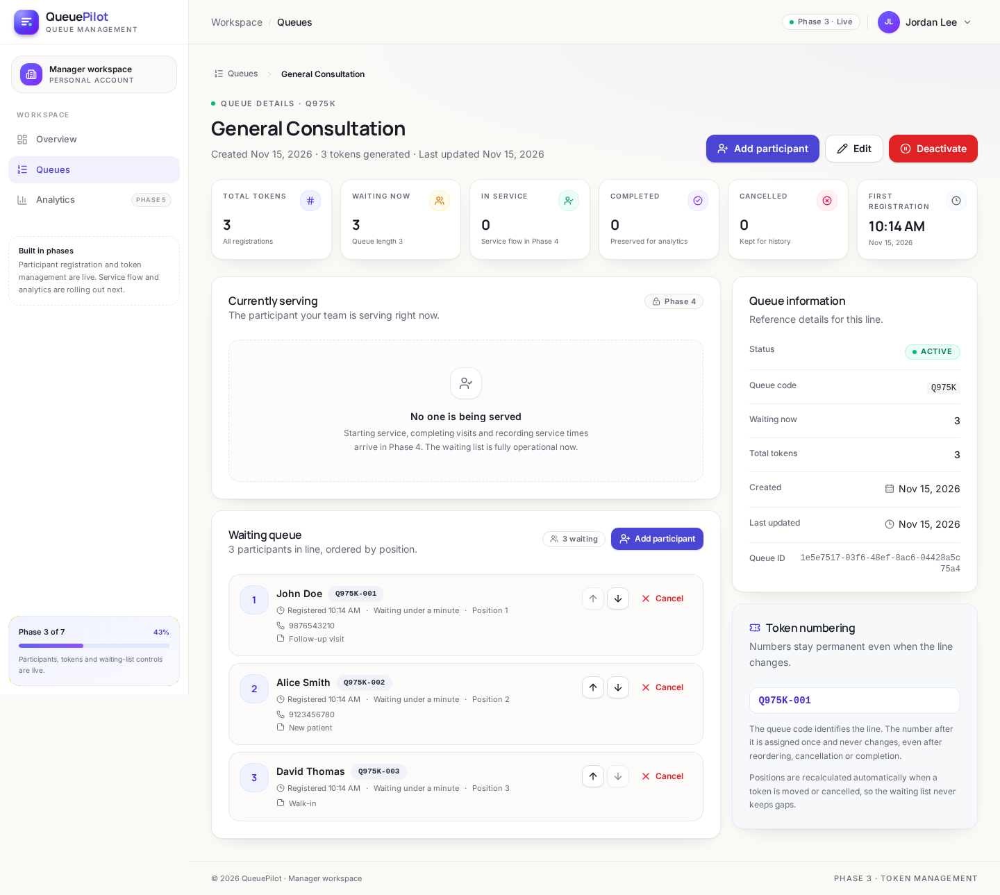
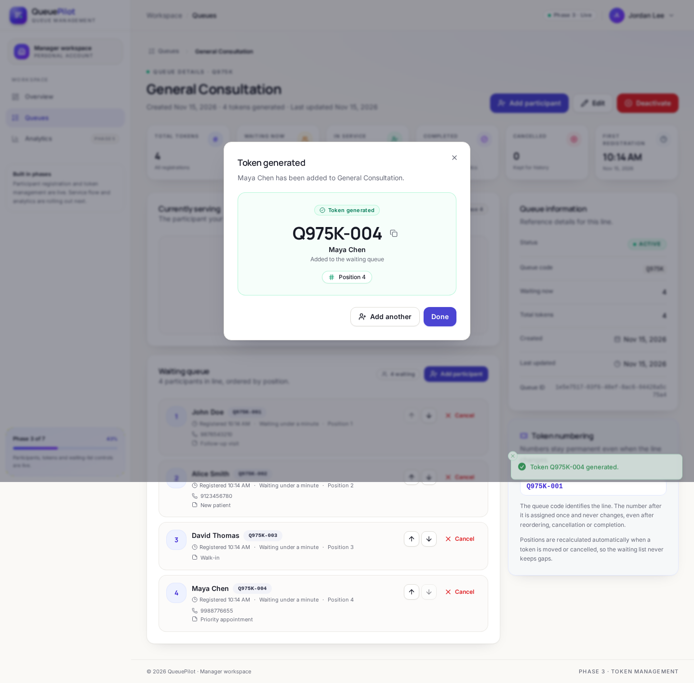
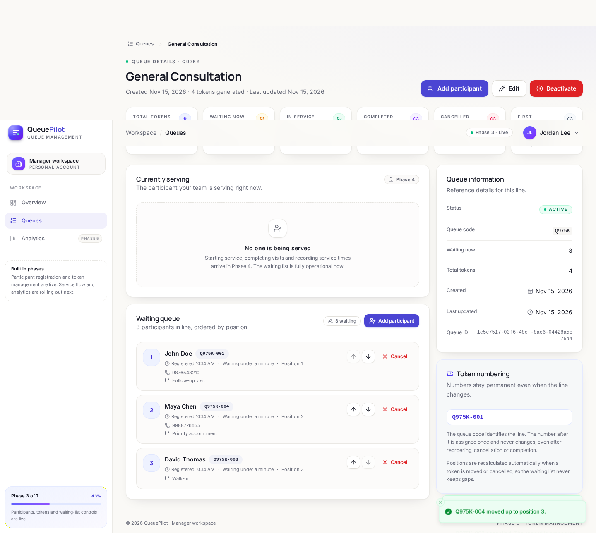
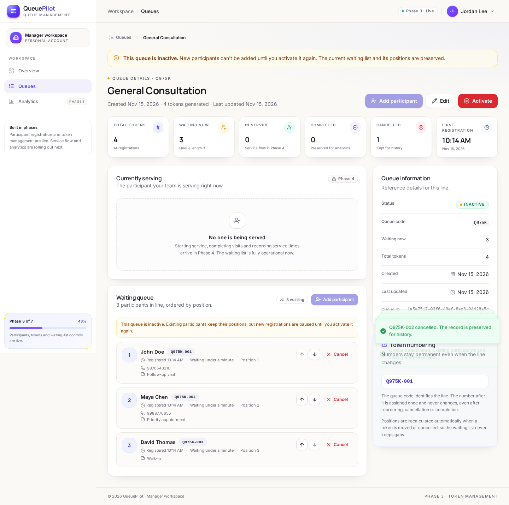
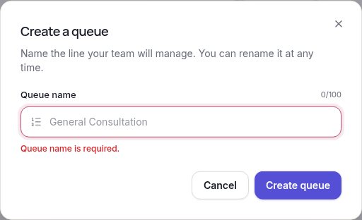
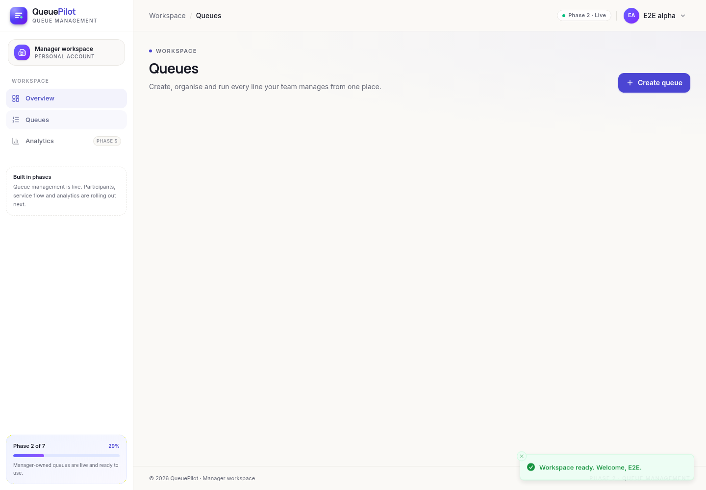
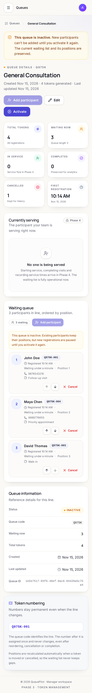
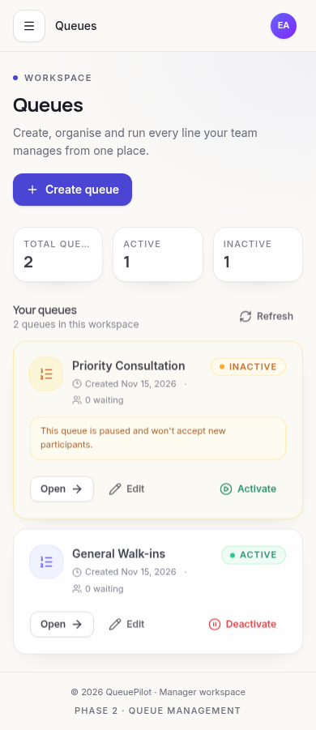
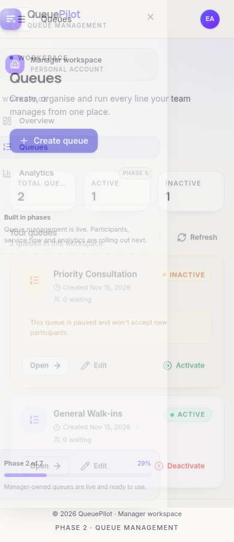

# QueuePilot

**Queue management, cleared for takeoff.**

QueuePilot is a full-stack queue management system for service teams. Managers create queues,
register participants, move tokens, run service, and understand their performance — all from one
calm, responsive workspace.

> **Current milestone: Phase 3 — Token management.** Managers can register participants, generate
> permanent tokens, reorder the waiting list, cancel visits, and read live queue statistics across
> the API and responsive UI. Service flow follows in Phase 4.

---

## Phase 3 at a glance

| Area                                                  | Status        |
| ----------------------------------------------------- | ------------- |
| Phase 1 foundation (auth, sessions, protected routes) | ✅ Complete   |
| Phase 2 queues (CRUD, ownership, active/inactive)     | ✅ Complete   |
| `Token` model, status enum, constraints & migration   | ✅ Complete   |
| Queue → token relationship with cascade delete        | ✅ Complete   |
| Sequential, concurrency-safe token generation         | ✅ Complete   |
| Participant registration API & validation             | ✅ Complete   |
| Waiting-list retrieval, status filters & statistics   | ✅ Complete   |
| Transactional move up / move down                     | ✅ Complete   |
| Cancellation with position normalisation              | ✅ Complete   |
| Add participant dialog with generated-token success   | ✅ Complete   |
| Waiting queue with reorder & cancel controls          | ✅ Complete   |
| Loading, empty, inactive, invalid & error states      | ✅ Complete   |
| Token API integration & concurrency tests             | ✅ 29 passing |
| Full API test suite                                   | ✅ 65 passing |
| Service flow, completion & analytics (Phase 4+)       | ⏳ Next       |

### Screens

| Sign in                                        | Create account                                           |
| ---------------------------------------------- | -------------------------------------------------------- |
|  |  |

| Manager overview                                    | Queue management                               |
| --------------------------------------------------- | ---------------------------------------------- |
|  |  |

| Live waiting queue                                           | Generated token dialog                                           |
| ------------------------------------------------------------ | ---------------------------------------------------------------- |
|  |  |

| Reordered and cancelled queue                                      | Inactive queue state                                           |
| ------------------------------------------------------------------ | -------------------------------------------------------------- |
|  |  |

| Create queue dialog                                       | Empty queue state                                          |
| --------------------------------------------------------- | ---------------------------------------------------------- |
|  |  |

| Mobile queue details                                               | Mobile queue management                              |
| ------------------------------------------------------------------ | ---------------------------------------------------- |
|  |  |

| Mobile navigation drawer                                    |
| ----------------------------------------------------------- |
|  |

| Analytics (Phase 5 preview)                                  | Mobile overview                                          |
| ------------------------------------------------------------ | -------------------------------------------------------- |
|  |  |

---

## Tech stack

| Layer    | Technology                                             |
| -------- | ------------------------------------------------------ |
| Frontend | React 19 + TypeScript + Vite 8                         |
| Styling  | Tailwind CSS 4 + shadcn-style component primitives     |
| UI       | Radix UI, Lucide icons, Sonner toasts                  |
| Forms    | React Hook Form + Zod                                  |
| Backend  | Node.js + Express 5 + TypeScript                       |
| Database | PostgreSQL 17                                          |
| ORM      | Prisma 6                                               |
| Auth     | Signed JWT (7-day default) in a `HttpOnly` cookie      |
| Testing  | Vitest + Supertest + isolated PostgreSQL test database |

The application follows a three-layer architecture: React presentation layer → Express application
layer → PostgreSQL data layer accessed through Prisma.

---

## Repository layout

```text
queue-manager/
├── apps/
│   ├── api/                    # Express API
│   │   ├── prisma/
│   │   │   ├── schema.prisma   # Manager + Queue + Token models and migrations
│   │   │   └── migrations/
│   │   ├── src/
│   │   │   ├── config/         # Validated environment configuration
│   │   │   ├── lib/            # Prisma client, errors, validation helpers
│   │   │   ├── middleware/     # Auth, error handling, rate limits, origin guard
│   │   │   ├── modules/
│   │   │   │   ├── auth/       # Register, login, logout, me
│   │   │   │   ├── health/     # API + database health
│   │   │   │   ├── queues/     # Queue schemas, service, controller, routes
│   │   │   │   └── tokens/     # Token registration, listing, reorder, cancel
│   │   │   ├── app.ts
│   │   │   └── index.ts
│   │   └── tests/              # Auth, hardening, queue & token integration tests
│   └── web/                    # React SPA
│       └── src/
│           ├── components/     # UI primitives, queue/token UI, layout, dashboard
│           ├── hooks/          # Queue list, queue workspace, health, document title
│           ├── lib/            # API client, formatting, navigation helpers
│           ├── pages/          # Dashboard, queues, queue details, auth
│           ├── providers/      # Auth context + session restoration
│           └── types/
├── docker/                     # Test-database bootstrap SQL
├── docs/                       # Phase notes + screenshots
├── docker-compose.yml
└── package.json                # npm workspaces + root scripts
```

---

## Quick start

### Prerequisites

- **Node.js 20.19+** and npm
- **Docker** (recommended) or a PostgreSQL 15+ server
- Ports `4000` (API), `5173` (web), and `5432` (Postgres) available

### 1. Install dependencies

```bash
npm install
```

> npm 12 blocks package install scripts by default. The required Prisma/esbuild scripts are
> allow-listed in the root `package.json` (`allowScripts`), so install works without manual approval.

### 2. Configure the API environment

```bash
cp apps/api/.env.example apps/api/.env
```

The example file works out of the box with the included Docker database. Before deploying or
sharing the project, replace `JWT_SECRET` with a long random value:

```bash
openssl rand -base64 48
```

### 3. Start PostgreSQL

```bash
npm run db:up
```

This starts Postgres 17 on `localhost:5432`, creates the `queuepilot` database, and initialises the
`queuepilot_test` database used by integration tests. Data lives in a named Docker volume.

Using your own PostgreSQL instead? Update `DATABASE_URL` in `apps/api/.env` and create both
databases.

### 4. Generate the Prisma client and apply migrations

```bash
npm run db:generate
npm run db:deploy
```

`db:deploy` applies the committed migration without prompting. Use `npm run db:migrate` only when you
change `schema.prisma` during development.

### 5. Start both apps

```bash
npm run dev
```

| Service      | URL                              |
| ------------ | -------------------------------- |
| Web app      | http://localhost:5173            |
| API          | http://localhost:4000            |
| Health check | http://localhost:4000/api/health |

Vite proxies `/api` to the API in development, so cookies stay first-party.

### 6. Create your manager account

Open **http://localhost:5173/register**, create an account, and you will land on the protected
overview. Accounts are real — there are no seeded demo credentials.

---

## Environment variables

### API (`apps/api/.env`)

| Variable           | Required | Default                 | Description                                                          |
| ------------------ | -------- | ----------------------- | -------------------------------------------------------------------- |
| `NODE_ENV`         | No       | `development`           | `development`, `test`, or `production`                               |
| `PORT`             | No       | `4000`                  | API port                                                             |
| `DATABASE_URL`     | **Yes**  | —                       | PostgreSQL connection string                                         |
| `JWT_SECRET`       | **Yes**  | —                       | Session signing key, minimum 32 characters                           |
| `SESSION_TTL_DAYS` | No       | `7`                     | Session lifetime (1–30 days)                                         |
| `CLIENT_ORIGINS`   | No       | `http://localhost:5173` | Comma-separated allowed browser origins                              |
| `COOKIE_NAME`      | No       | `qp_session`            | Session cookie name                                                  |
| `COOKIE_SECURE`    | No       | `auto`                  | `auto`, `true`, or `false`; `auto` is secure in production           |
| `COOKIE_SAME_SITE` | No       | `auto`                  | `auto`, `lax`, `strict`, or `none`; `auto` uses `none` in production |
| `COOKIE_DOMAIN`    | No       | —                       | Optional cookie domain for subdomains                                |
| `TRUST_PROXY`      | No       | `0`                     | Set to `1` behind a reverse proxy / load balancer                    |

The API validates its environment at boot and refuses to start with an invalid configuration.

### Web (`apps/web/.env`)

| Variable           | Required | Description                                                                                                      |
| ------------------ | -------- | ---------------------------------------------------------------------------------------------------------------- |
| `VITE_API_URL`     | No       | Absolute API URL when the API is on a different origin. Leave empty to use the dev proxy / same-origin requests. |
| `VITE_DEV_API_URL` | No       | Dev proxy target. Defaults to `http://localhost:4000`.                                                           |

Copy `apps/web/.env.example` to `apps/web/.env` only if you need to override these values.

---

## Available scripts

Run from the repository root:

| Script                      | Description                                    |
| --------------------------- | ---------------------------------------------- |
| `npm run dev`               | Run API and web app together                   |
| `npm run dev:api`           | Run only the API with hot reload               |
| `npm run dev:web`           | Run only the web app                           |
| `npm run build`             | Production build of API and web                |
| `npm run typecheck`         | TypeScript checks for both apps                |
| `npm test`                  | API integration tests (isolated test database) |
| `npm run format`            | Format with Prettier                           |
| `npm run db:up` / `db:down` | Start / stop the Docker database               |
| `npm run db:generate`       | Generate the Prisma client                     |
| `npm run db:deploy`         | Apply committed migrations                     |
| `npm run db:migrate`        | Create/apply a development migration           |
| `npm run db:studio`         | Open Prisma Studio                             |

---

## API reference (implemented)

All endpoints are prefixed with `/api`. Responses are JSON. Protected endpoints accept the session
cookie automatically, or an `Authorization: Bearer <token>` header.

### Authentication

| Method | Endpoint             | Auth     | Description                                  |
| ------ | -------------------- | -------- | -------------------------------------------- |
| `POST` | `/api/auth/register` | Public   | Create a manager account and start a session |
| `POST` | `/api/auth/login`    | Public   | Authenticate and start a session             |
| `POST` | `/api/auth/logout`   | Public   | Clear the session cookie                     |
| `GET`  | `/api/auth/me`       | Required | Return the current manager                   |

**Register request**

```json
{
  "name": "Ada Lovelace",
  "email": "ada@example.com",
  "password": "Analytical1"
}
```

**Success response** — `201 Created`

```json
{
  "manager": {
    "id": "d9a9e6f0-…",
    "name": "Ada Lovelace",
    "email": "ada@example.com",
    "createdAt": "2026-11-15T00:00:00.000Z",
    "updatedAt": "2026-11-15T00:00:00.000Z"
  }
}
```

A `Set-Cookie` header carries the signed session. Password hashes and other sensitive columns are
never returned.

### Health

| Method | Endpoint      | Auth   | Description                            |
| ------ | ------------- | ------ | -------------------------------------- |
| `GET`  | `/api/health` | Public | API uptime and PostgreSQL connectivity |

### Queues

All queue endpoints require a session and are scoped to the authenticated manager. A queue that
belongs to another manager is reported as `404 QUEUE_NOT_FOUND`, exactly like a missing queue, so
the API never reveals whether an ID exists elsewhere. `managerId` is always derived from the session
and is never accepted from the request body.

| Method  | Endpoint                 | Description                                |
| ------- | ------------------------ | ------------------------------------------ |
| `POST`  | `/api/queues`            | Create a queue (status defaults to ACTIVE) |
| `GET`   | `/api/queues`            | List the manager's queues, newest first    |
| `GET`   | `/api/queues/:id`        | Get one queue with ownership enforcement   |
| `PATCH` | `/api/queues/:id`        | Rename a queue                             |
| `PATCH` | `/api/queues/:id/status` | Activate or deactivate a queue             |

Queue responses use the `{ "success": true, "data": … }` envelope:

```json
{
  "success": true,
  "data": {
    "id": "f26152d1-07a2-4c89-ad6f-3ea4f410e659",
    "name": "General Consultation",
    "status": "ACTIVE",
    "code": "Q7F2",
    "createdAt": "2026-11-15T00:00:00.000Z",
    "updatedAt": "2026-11-15T00:00:00.000Z",
    "waitingCount": 3
  }
}
```

`waitingCount` is a live count of `WAITING` tokens. `code` is a short queue prefix used in display
tokens such as `Q7F2-003`. Queue names are trimmed, internal whitespace is collapsed, and the maximum
length is 100 characters. Status updates accept `ACTIVE` or `INACTIVE`; deactivation preserves the
queue, its waiting participants, and its history rather than deleting it. Deactivation is rejected
while a token is `IN_SERVICE`.

### Tokens

Token endpoints require a session and are scoped through the token's queue. A token or queue owned by
another manager returns the same `404` as a missing record. Display tokens compose the queue code and
the permanent token number; positions are separate and only apply to `WAITING` tokens.

| Method  | Endpoint                  | Description                                           |
| ------- | ------------------------- | ----------------------------------------------------- |
| `POST`  | `/api/queues/:id/tokens`  | Register a participant and generate a token           |
| `GET`   | `/api/queues/:id/tokens`  | Get the waiting list, current service, and statistics |
| `GET`   | `/api/tokens/:id`         | Get one owned token                                   |
| `PATCH` | `/api/tokens/:id/reorder` | Move a waiting token `UP` or `DOWN`                   |
| `POST`  | `/api/tokens/:id/cancel`  | Cancel a waiting token and preserve its record        |

**Register request**

```json
{
  "participantName": "John Doe",
  "contactNumber": "9876543210",
  "notes": "General consultation"
}
```

`201 Created`

```json
{
  "success": true,
  "data": {
    "id": "2a4c9f78-…",
    "tokenNumber": 4,
    "displayToken": "Q7F2-004",
    "participantName": "John Doe",
    "contactNumber": "9876543210",
    "notes": "General consultation",
    "status": "WAITING",
    "position": 4,
    "queueId": "f26152d1-…",
    "createdAt": "2026-11-15T10:00:00.000Z",
    "updatedAt": "2026-11-15T10:00:00.000Z",
    "serviceStartedAt": null,
    "serviceCompletedAt": null,
    "cancelledAt": null
  }
}
```

**Queue workspace response** (`GET /api/queues/:id/tokens?status=ALL`)

```json
{
  "success": true,
  "data": {
    "queue": { "id": "f26152d1-…", "name": "General Consultation", "code": "Q7F2" },
    "currentlyServing": null,
    "waiting": [
      {
        "id": "2a4c9f78-…",
        "displayToken": "Q7F2-001",
        "participantName": "John",
        "position": 1,
        "status": "WAITING"
      }
    ],
    "waitingCount": 1,
    "stats": {
      "totalGenerated": 1,
      "waitingCount": 1,
      "inServiceCount": 0,
      "completedCount": 0,
      "cancelledCount": 0,
      "currentQueueLength": 1,
      "earliestRegistrationAt": "2026-11-15T10:00:00.000Z"
    },
    "tokens": []
  }
}
```

`status` accepts `WAITING`, `IN_SERVICE`, `COMPLETED`, `CANCELLED`, or `ALL`. `waiting` is always
ordered by position. `tokens` is newest-first and is intended for history views. Statistics are
computed with PostgreSQL aggregates, not frontend counters.

**Reorder request** — `PATCH /api/tokens/:id/reorder`

```json
{ "direction": "UP" }
```

The response contains the moved token and the complete ordered waiting list. Moving the first token
up or the last token down returns `409 TOKEN_REORDER_BOUNDARY`.

**Cancellation request** — `POST /api/tokens/:id/cancel`

```json
{
  "success": true,
  "message": "Token cancelled successfully",
  "data": {
    "token": { "status": "CANCELLED", "position": null },
    "waiting": [],
    "waitingCount": 0,
    "stats": {}
  }
}
```

Cancellation sets `cancelledAt`, preserves the permanent token number, removes the token from the
active waiting list, and renumbers the remaining positions from `1..n`.

### Error format

```json
{
  "error": {
    "code": "INVALID_CREDENTIALS",
    "message": "Incorrect email or password."
  }
}
```

Validation failures add a `details.fieldErrors` object. Known codes:
`VALIDATION_ERROR`, `INVALID_JSON`, `UNAUTHORIZED`, `FORBIDDEN`, `NOT_FOUND`, `QUEUE_NOT_FOUND`,
`QUEUE_INACTIVE`, `QUEUE_IN_SERVICE`, `TOKEN_NOT_FOUND`, `TOKEN_NOT_WAITING`,
`TOKEN_REORDER_BOUNDARY`, `EMAIL_TAKEN`, `INVALID_CREDENTIALS`, `RATE_LIMITED`, `INTERNAL_ERROR`.

---

## Authentication & security design

- Passwords are hashed with **bcrypt** (cost 12) and are never logged or returned.
- Sessions are **signed JWTs** (`HS256`, issuer + audience checked) with a 7-day default lifetime.
- The JWT is delivered in a **`HttpOnly`, `SameSite`, `Secure`-aware cookie** and is never exposed to
  client JavaScript.
- Login is timing-resistant: unknown emails still run a bcrypt comparison against a dummy hash.
- **Ownership-ready middleware**: protected routes resolve the manager from the database on every
  request, so deleted/invalid accounts are rejected immediately.
- **Queue ownership**: every create/list/read/update/status query is scoped by the authenticated
  manager's ID. Cross-manager access returns the same `404` as a missing queue.
- **CSRF defence-in-depth**: state-changing requests with an unknown browser `Origin` are rejected.
- **CORS** is allow-listed and credentialed; cookies are scoped to `/`.
- Auth endpoints are **rate limited** (25 attempts / 15 minutes / IP).
- **Helmet** security headers, 100 KB JSON body limit, and generic 500 responses in production.
- Input is validated with **Zod** on the server. Email uniqueness is normalised (trim + lowercase),
  and database `P2002` races are converted into a clean `409 EMAIL_TAKEN`.
- API errors use a consistent envelope; stack traces and database internals never reach the client.
- The API refuses to boot with missing or invalid environment variables.

> **Stateless-session note:** logout clears the cookie. Because JWTs are self-contained, an already
> copied token remains valid until expiry; production hardening could add a token version or session
> table for immediate server-side revocation.

---

## Database

Phase 1 introduced the `managers` table:

| Column          | Type         | Notes                        |
| --------------- | ------------ | ---------------------------- |
| `id`            | UUID         | Primary key                  |
| `name`          | VARCHAR(120) | Display name                 |
| `email`         | VARCHAR(255) | Unique, normalised lowercase |
| `password_hash` | VARCHAR(255) | bcrypt hash                  |
| `created_at`    | TIMESTAMPTZ  | Registration time            |
| `updated_at`    | TIMESTAMPTZ  | Last update                  |

Phase 2 adds the `queues` table and a `QueueStatus` enum:

| Column       | Type          | Notes                                      |
| ------------ | ------------- | ------------------------------------------ |
| `id`         | UUID          | Primary key                                |
| `name`       | VARCHAR(100)  | Trimmed, whitespace-collapsed display name |
| `status`     | `QueueStatus` | `ACTIVE` (default) or `INACTIVE`           |
| `manager_id` | UUID          | FK → `managers.id`, `ON DELETE CASCADE`    |
| `created_at` | TIMESTAMPTZ   | Creation time                              |
| `updated_at` | TIMESTAMPTZ   | Last rename or status change               |

An index on `(manager_id, created_at)` supports the newest-first queue listing.

Phase 3 adds the `tokens` table and a `TokenStatus` enum, plus two queue columns used for display
tokens and safe numbering:

| Column                 | Type          | Notes                                                       |
| ---------------------- | ------------- | ----------------------------------------------------------- |
| `id`                   | UUID          | Primary key                                                 |
| `token_number`         | INTEGER       | Permanent, unique per queue                                 |
| `position`             | INTEGER NULL  | Waiting-list order only; `NULL` outside the waiting list    |
| `participant_name`     | VARCHAR(100)  | Trimmed and whitespace-collapsed                            |
| `contact_number`       | VARCHAR(32)   | Optional                                                    |
| `notes`                | VARCHAR(500)  | Optional                                                    |
| `status`               | `TokenStatus` | `WAITING` (default), `IN_SERVICE`, `COMPLETED`, `CANCELLED` |
| `queue_id`             | UUID          | FK → `queues.id`, `ON DELETE CASCADE`                       |
| `created_at`           | TIMESTAMPTZ   | Registration time                                           |
| `updated_at`           | TIMESTAMPTZ   | Last change                                                 |
| `service_started_at`   | TIMESTAMPTZ   | Reserved for Phase 4                                        |
| `service_completed_at` | TIMESTAMPTZ   | Reserved for Phase 4                                        |
| `cancelled_at`         | TIMESTAMPTZ   | Cancellation time                                           |

Queue additions:

| Column              | Type       | Notes                                              |
| ------------------- | ---------- | -------------------------------------------------- |
| `code`              | VARCHAR(8) | Unique display prefix, e.g. `Q7F2`                 |
| `next_token_number` | INTEGER    | Monotonic counter allocated under a queue row lock |

Constraints and indexes:

- `UNIQUE (queue_id, token_number)` — permanent token numbers are never reused.
- `UNIQUE (queue_id, position)` — one token per waiting position; multiple `NULL`s are allowed.
- `INDEX (queue_id, status, position)` — waiting-list reads.
- `INDEX (queue_id, created_at)` — history reads.

All three migrations are committed under `apps/api/prisma/migrations/`. The token migration backfills
stable queue codes for queues created before Phase 3.

---

## Testing

```bash
npm test
```

- Runs 65 integration tests with Vitest + Supertest against `queuepilot_test` (16 auth/hardening,
  20 queue, 29 token).
- Auth coverage includes registration, normalisation, duplicate emails, password rules, login,
  timing-safe failures, session restoration, bearer auth, logout, CSRF origin rejection, malformed
  JSON, and health checks.
- Queue coverage includes authentication on every endpoint, creation and whitespace normalisation,
  empty/oversized names, ignored client `managerId`, empty and newest-first listings, details,
  cross-manager isolation, malformed/unknown IDs, renaming, and activate/deactivate round trips.
- Token coverage includes registration, sequential numbers and positions, inactive queues,
  validation and ignored client identity fields, queue/token ownership, ordered retrieval, status
  filters, statistics, reorder boundaries, cancellation, double cancellation, number non-reuse,
  live waiting counts, deactivation guards, ten-way concurrent registration, and concurrent
  reordering.
- The test runner resets and applies the Prisma schema to the isolated test database automatically.

The queue workflows were also verified in a real browser across desktop and mobile widths:
registration → generated token → ordered waiting list → move up/down → cancellation confirmation →
position normalisation → refresh persistence → inactive queue → validation and error states, with no
unexpected console errors and no horizontal overflow.

---

## Phase 3 acceptance check

| Requirement                    | Verification                                                                         |
| ------------------------------ | ------------------------------------------------------------------------------------ |
| Register participant           | Add Participant dialog or `POST /api/queues/:id/tokens`; token created as `WAITING`  |
| Generate unique token          | Numbers allocated from a locked per-queue counter; unique `(queue_id, token_number)` |
| Sequential numbers             | Multiple registrations receive `1, 2, 3…` and append at the end of the line          |
| Inactive queue                 | Registration returns `409 QUEUE_INACTIVE`; UI disables Add Participant               |
| Move token up                  | Position decreases; permanent token number is unchanged                              |
| Move token down                | Position increases; permanent token number is unchanged                              |
| First token up                 | `409 TOKEN_REORDER_BOUNDARY`; UI disables the button                                 |
| Last token down                | `409 TOKEN_REORDER_BOUNDARY`; UI disables the button                                 |
| Cancel waiting token           | Status becomes `CANCELLED`, timestamp recorded, waiting list renumbered              |
| Cancel same token twice        | Second request returns `409 TOKEN_NOT_WAITING`                                       |
| Refresh queue page             | Numbers, order, statuses, and statistics reload from PostgreSQL                      |
| Concurrent registration        | Ten simultaneous registrations produce unique sequential numbers and positions       |
| Concurrent reorder             | Queue lock keeps ordering consistent and every position unique                       |
| Another manager's token        | `404 TOKEN_NOT_FOUND`; no data or existence leak                                     |
| Queue statistics               | Totals, waiting, in-service, completed, cancelled, length, earliest registration     |
| Loading / empty / error states | Skeletons, empty CTA, inactive banner, not-found and retryable error states          |
| Stale data protection          | In-flight reloads are invalidated after mutations                                    |
| Responsive UI                  | Queue workspace usable at desktop and mobile widths without horizontal overflow      |

Phase 1 verification remains documented in [`docs/PHASE-1.md`](docs/PHASE-1.md). Phase 2 design
decisions and manual checks are in [`docs/PHASE-2.md`](docs/PHASE-2.md). Phase 3 data model,
concurrency strategy, API contract, and test matrix are in
[`docs/PHASE-3.md`](docs/PHASE-3.md).

---

## Deployment notes (for later phases)

The intended production split is **Vercel (web) + Render (API) + Neon PostgreSQL**:

1. Set `NODE_ENV=production`, a strong `JWT_SECRET`, and the Neon `DATABASE_URL` on the API host.
2. Run `npx prisma migrate deploy` as part of the API release/build step.
3. Set `CLIENT_ORIGINS=https://your-web-domain` and `TRUST_PROXY=1`.
4. Because the web and API are on different sites, use `COOKIE_SECURE=true` and
   `COOKIE_SAME_SITE=none`. Both services must be served over HTTPS.
5. Set `VITE_API_URL=https://your-api-domain` in the web build environment.

---

## Roadmap

| Phase | Scope                                                     | Status      |
| ----- | --------------------------------------------------------- | ----------- |
| 1     | Project setup, database, authentication, protected routes | ✅ Complete |
| 2     | Queue creation, listing, details, rename, activation      | ✅ Complete |
| 3     | Participant registration, tokens, ordering, cancellation  | ✅ Complete |
| 4     | Next token, service completion, concurrency safety        | Next        |
| 5     | Analytics overview, trends, wait times, filters           | Planned     |
| 6     | UI polish, responsive QA, edge-case testing               | Planned     |
| 7     | Deployment, README, demo                                  | Planned     |

See [`docs/PHASE-3.md`](docs/PHASE-3.md) for the token data model, concurrency strategy, API
contract, and test matrix, [`docs/PHASE-2.md`](docs/PHASE-2.md) for queue management, and
[`docs/PHASE-1.md`](docs/PHASE-1.md) for the foundation.

---

## Troubleshooting

| Symptom                                            | Fix                                                                                   |
| -------------------------------------------------- | ------------------------------------------------------------------------------------- |
| API exits with “Invalid environment configuration” | Copy `apps/api/.env.example` → `apps/api/.env`; ensure `JWT_SECRET` is 32+ characters |
| `Can’t reach server` on auth screens               | Confirm the API is running on port 4000 and `curl localhost:4000/api/health` succeeds |
| `P1001: Can’t reach database`                      | Run `npm run db:up`; check `DATABASE_URL` and port 5432                               |
| Test DB missing                                    | Recreate the volume with `npm run db:down && docker compose down -v && npm run db:up` |
| Session not persisted in production                | Use HTTPS, `COOKIE_SECURE=true`, `COOKIE_SAME_SITE=none`, and exact `CLIENT_ORIGINS`  |
| Prisma client missing                              | Run `npm run db:generate`                                                             |
